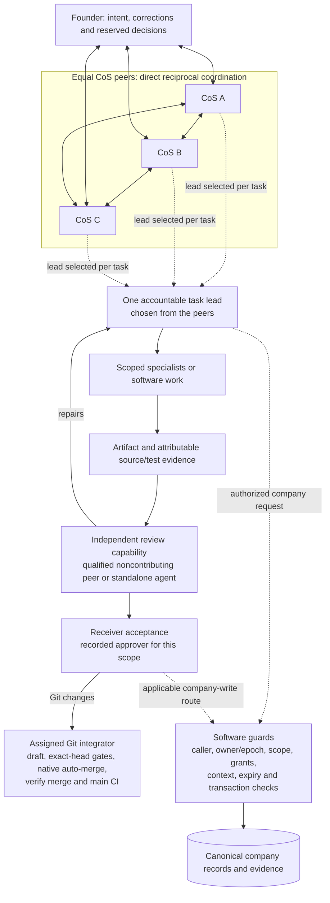
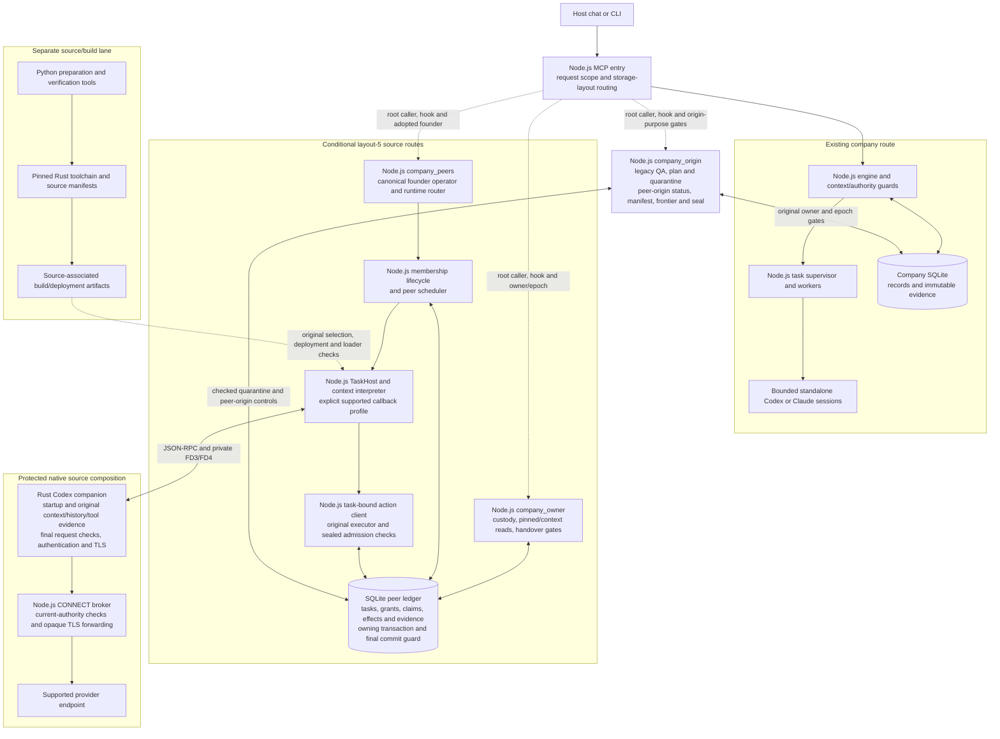
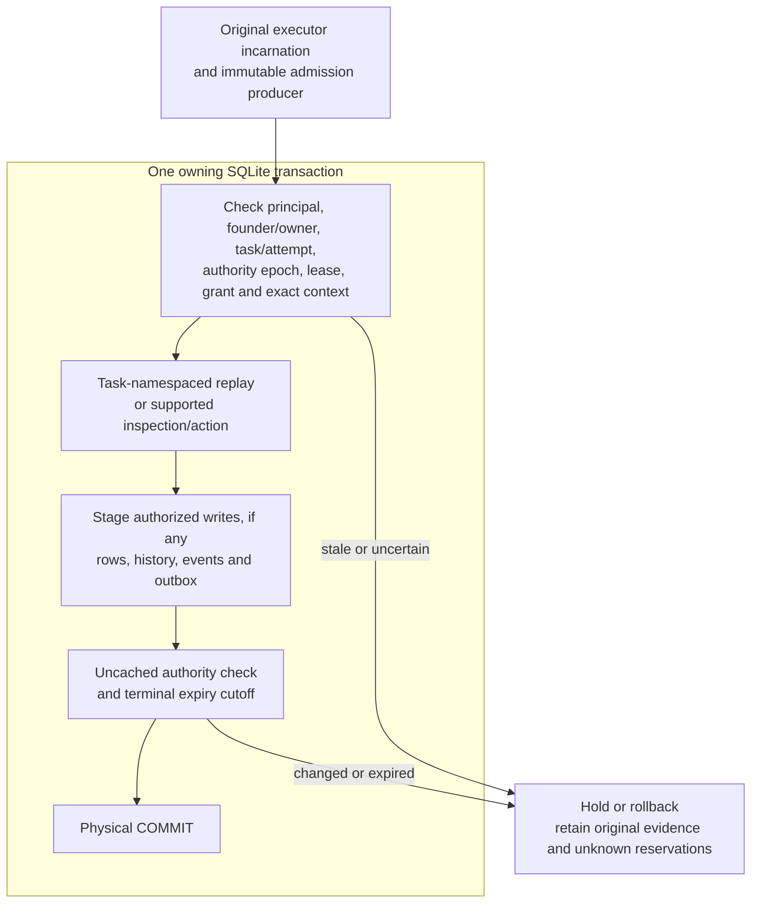

# SoloCo architecture

Source snapshot: [`b72f9c4`](https://github.com/yimoburu/soloco/commit/b72f9c4cb2ad0502f53f35ea06fd916bbf342c8b), November 12, 2026.
This map describes implemented repository interfaces. Installed packages,
connected MCP processes, qualified native execution and company adoption are
separate states; each requires its own evidence.

## CoS collaboration and task accountability

CoSes are peers. They communicate directly, select one accountable lead for each
task, and consult the affected peers. Leading a task is a responsibility, not a
permanent rank. Independent review can come from a qualified noncontributing CoS
or standalone agent. The receiver's acceptance is a separate decision.

The company still has one registered owner at a time. Communication permission
does not confer company-write authority or transfer ownership. Review, receiver
acceptance, Git integration and company mutation are distinct responsibilities.
The receiver-acceptance node is a decision/evidence boundary; it does not imply
that public peer readers expose an acknowledgement or publication endpoint.

## Software and language boundaries

All arrows below describe source wiring. The layout-5 peer routes require checked
adoption, original producers, current authority and the applicable qualified host
recipe. Drawing those routes does not establish that a company has adopted them.

Rust extends the existing Codex internals where original session, instruction,
model, response and tool-return evidence is produced and the final authenticated
request is sent. Authentication and TLS remain in Rust; the Node broker forwards
opaque TLS bytes. Node.js owns company APIs, scheduling, policy, persistence
coordination, the TaskHost and broker. Python prepares and verifies native source
and build inputs in a separate tooling lane.

`company_peer_adoption` provides read-only preparation. It does not migrate or
adopt a company. The owner and origin routes also retain their original producer,
custody, operating-state and qualification requirements. A current source
interface or matching package is not proof of installed-host activation,
historical launch coverage, global capacity, old-actor isolation or continuity.

## Task-bound inspection, replay and writes

Current source implements a useful task-bound client and a physical precommit
guard. The historical always-unavailable preparation drafts are not the current
implementation. See [task-bound peer actions](peer-task-effects.md).

The explicit `task-bound-effects` profile supports its own `task/get` and
`task/context` inspections, scoped `message/send`, `notice/create` and
`home/propose`, and `handoff/accept` or `handoff/reject` for the exact admitted
typed handoff. It does not expose arbitrary execution, GitHub
publication, home publication or company/grant control. The read-only foundation
profile remains independently restricted. Protected process/result/closure
recording preserves its separate reconciliation path; stopping a runtime does
not prove descendant or remote-model closure or release unknown reservations.

## Source anchors and operational boundaries

| Area | Current source and explanation |
| --- | --- |
| MCP and ordinary company runtime | [`main.mjs`](../plugins/soloco/runtime/main.mjs), [`engine.mjs`](../plugins/soloco/runtime/engine.mjs), [durable tasks](async-runtime.md) |
| Peer operator, membership and scheduler wiring | [`peer-runtime.mjs`](../plugins/soloco/runtime/peer-runtime.mjs), [production routing](peer-production-runtime.md) |
| Owner and origin controls | [public owner routing](peer-public-owner-routing.md), [original-state mechanical QA](peer-origin-mechanical-qa-public.md), [frontier checkpoint](peer-input-frontier-checkpoint.md), [final seal](peer-origin-frontier-seal.md) |
| Task authority and physical commit checks | [`model.mjs`](../plugins/soloco/runtime/peers/model.mjs), [`ledger.mjs`](../plugins/soloco/runtime/peers/ledger.mjs), [task-bound actions](peer-task-effects.md) |
| Node host and network broker | [`codex-task-host.mjs`](../plugins/soloco/runtime/peers/codex-task-host.mjs), [`protected-connect-broker.mjs`](../plugins/soloco/runtime/peers/protected-connect-broker.mjs), [bridge topology](protected-peer-bridge.md) |
| Native Rust companion | [`soloco_protected_host.rs`](../native/codex/overlay/codex-rs/app-server-client/src/bin/soloco_protected_host.rs), [`protected_peer.rs`](../native/codex/overlay/codex-rs/codex-api/src/protected_peer.rs), [native source profile](native-peer-source-profile.md) |
| Native source/build tooling | [`protected_native.py`](../native/codex/tools/protected_native.py), [pinned source package](../native/codex/README.md) |

The earlier bridge-only diagram described a source composition before public peer
routing was added. The current public route is implemented, while actual
adoption/native qualification remains separate. Source/library tests, installed
bytes, connected hooks, genuine host/account operation and company acceptance
must retain their own exact evidence. Preflight measures context geometry;
complete delivery does not establish understanding or native fit. Existing
failed attempts, capacity and notice conditions keep their repair requirements.

See [current capabilities](current-capabilities.md), [SPEC evidence](spec-reconciliation.md),
[caller context](mcp-caller-identity.md), [lossless origin context](origin-mechanical-qa-lossless-wire.md)
and [CI delivery rules](ci.md) for the detailed boundaries.
