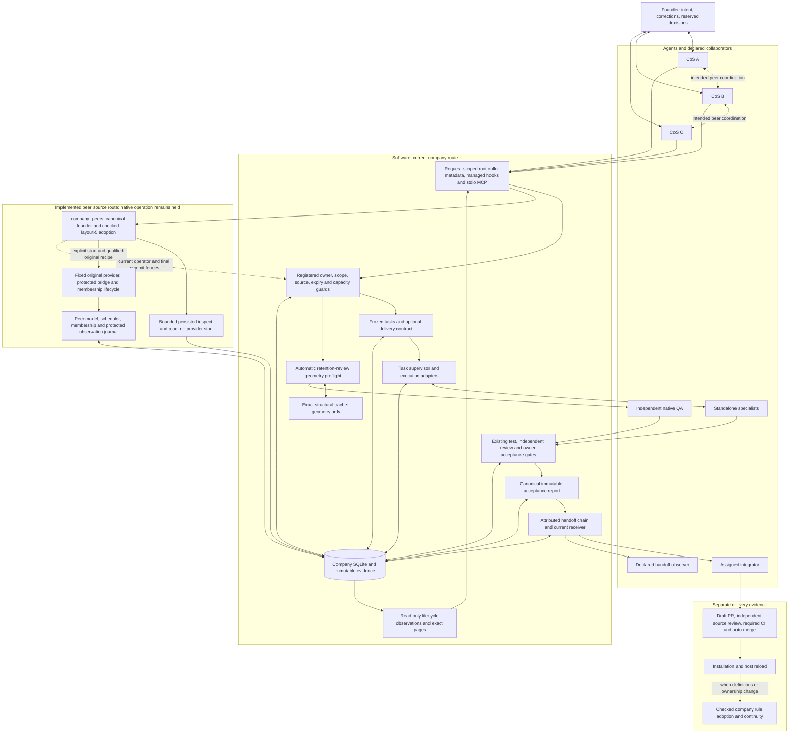

# SoloCo source architecture

This diagram retains the historical merged main checkpoint
`050d9b8a248314ffc02f371708fa69902f138d85`
(through PR #94, November 12, 2026). The later public source additions are mapped
below; the original diagram is not a claim about their native readiness.
It maps implemented source composition;
installation, hook activation, native qualification and company adoption need
their own evidence.
The founder works with CoS agents; the supervisor, guard and storage boxes are
software. CoS peers are intended equals with per-task accountability. The current
production company route retains one registered owner; observer chats do not gain
that authority by reading a repository or receiving a message.

Preflight measures delivery geometry before an attempt; it cannot establish
understanding. Cache reuse never substitutes for fresh authority or independent
judgment. Acceptance reports preserve the actual local gate and failed history.
External handoff observations do not themselves authenticate GitHub, installation
or adoption. Unknown process closure keeps its reservation. Current compulsory
notices, including earlier continuity, timeout and retention failures, retain
their own repair requirements.

At later merged main
[`b0097c3`](https://github.com/yimoburu/soloco/commit/b0097c3b86e7f500e35b70e391aa2beeb8f4b4cf),
the original [frontier checkpoint](peer-input-frontier-checkpoint.md) and
[final-seal](peer-origin-frontier-seal.md) APIs (PR #104) supply checked source
composition, not ordinary bootstrap or native launch. The separate
`company_origin` route supplies [pre-quarantine mechanical-QA controls](peer-origin-mechanical-qa-public.md)
and storage/catalog guards (PR #106); its [fixed lossless context](origin-mechanical-qa-lossless-wire.md)
(PR #107) preserves the exact original assignment DATA without relaxing the actual prompt
limit or replacing a missing execution-inventory producer. Original generations,
UNKNOWN reservations and existing authority remain binding. [Three-shard routine
CI](ci.md) (PR #108) passed all six jobs and 3,759 tests at that exact main
[source run](https://github.com/yimoburu/soloco/actions/runs/43326025667); it does
not activate an installed v0.7.8 runtime, qualify native operation, adopt a company
or clear the three previously held notices.

The public peer route requires the actual canonical founder and current owner
epoch. Caller metadata alone grants no authority. Its source composition cannot
initialize or adopt legacy storage, qualify a native host, or clear the existing
legacy-origin execution hold. The registered `company_owner` and
`company_origin` source routes do not establish usable native transfer or
maintenance: their original producers, qualified host and applicable acceptance
are still required. See [public owner routing](peer-public-owner-routing.md),
[peer production routing](peer-production-runtime.md) and
[MCP caller context](mcp-caller-identity.md).

See [current capabilities](current-capabilities.md),
[SPEC evidence](spec-reconciliation.md), [implementation flow](implementation-speed.md)
and [handoff interfaces](development-delivery.md) for exact boundaries.
