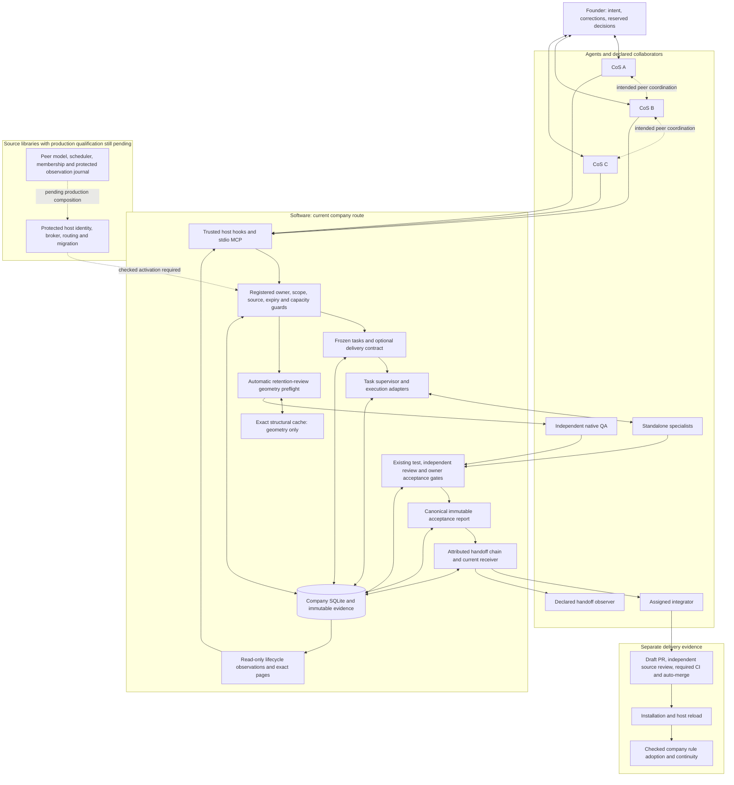

# SoloCo source architecture

This diagram covers the source follow-ups based on main through PR #74. It is a
source map, not evidence of installation, hook activation or company adoption.
The founder works with CoS agents; the supervisor, guard and storage boxes are
software. CoS peers are intended equals with per-task accountability. The current
production company route retains one registered owner; observer chats do not gain
that authority by reading a repository or receiving a message.

Preflight measures delivery geometry before an attempt; it cannot establish
understanding. Cache reuse never substitutes for fresh authority or independent
judgment. Acceptance reports preserve the actual local gate and failed history.
External handoff observations do not themselves authenticate GitHub, installation
or adoption. Unknown process closure keeps its reservation. Current compulsory
notices, including earlier continuity, timeout and retention failures, retain
their own repair requirements.

See [current capabilities](current-capabilities.md),
[SPEC evidence](spec-reconciliation.md), [implementation flow](implementation-speed.md)
and [handoff interfaces](development-delivery.md) for exact boundaries.
