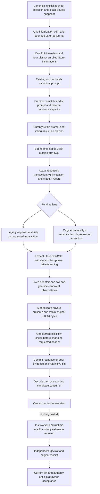

# Issue 18 comparison integration

This change authors an explicit Source qualification path for the four existing
comparison arms. It is unqualified until the composed commit has its selected
checks, independent review and owner acceptance. Version 0.7.10 preserves the
published 0.7.9 compatibility paths and pinned company instructions. Installing
these bytes does not select a comparison, change governance or adopt a runtime.

The supported entry is an explicit same-process call to the existing worker:
`work(root, jobId, runRuntimeModel, privateComparisonPlan)`. The plan comes from
`createComparisonWorkerPlanFrom(run, actualStore, armId, jobId, prerequisite)`.
Normal calls omit the fourth argument. Importing the ordinary worker or Store
does not initialize a comparison, read Python helper Source or start a helper.

The qualification route exercises the actual worker template and existing
candidate consumer. It does not implement private-brand transfer to a fresh
standalone worker, a production multi-process broker, cold run adoption or host
lifecycle recovery. The controlled child-process fixtures are prospective Source
checks and have not run on this composition. They cannot establish Native model
output fidelity or supported-host behavior.
The current comparison caller requires normalized layout 4 and a fresh,
bounded request job; unsupported layouts or proof-envelope capacity hold
before A storage initialization or B slot consumption. E3's fixed event and
two-phase COMMIT coupling is now composed in Source; the combined checks remain
unrun. The diagram describes the intended flow. The separate test-worker path
still needs the accounting-custody extension described below.

## Selection and global accounting

The issuer accepts the exact canonical `human_founder` control record, its
whole-record hash, the current owner and epoch, a live actual Store and a
private physical Source snapshot. Generic saved text, callback identity,
matching JSON or a hash-shaped Source tuple cannot replace these inputs. The
snapshot binds the actual Git commit/tree, closed runtime/tool namespace,
release/team inputs, Node executable and the fixed Original generation. This
is physical checkout custody; it does not authenticate a loaded Native host.

The selection purpose is `issue18-integrated-comparison-budget-v1`. Its policy
references remain exact canonical records. The model-policy definition pins
the proposed engineer/QA tuple and independence rules while explicitly
granting no execution authority. Existing job and runtime grants are required
separately. This implementation performs no real selection.

The revisionless human control record stays revisionless. A derived revision-1
selection anchor supplies B's positive-revision reference. Initial selection
and journal creation use exclusive files before descriptor-relative directory
creation. All known selection copies, external anchor, journal, spends and
poison/initialization metadata share the fixed 32 KiB issuer ceiling. B retains
exactly its manifest and eight original slot leaves. A objects use separate
Source-selected sibling directories.

All four arm Store/root/database incarnations must be distinct before any
slot is published. QA must reuse its engineer's arm. A slot is spent and its
immutable file acknowledged before entering arm SQL; rollback, COMMIT
uncertainty, snapshot failure or a lost acknowledgement never refunds it.
Cold files and serialized SlotCommit/ArmCommit records are audit data.

## Request and outcome custody

The worker issues a lexical prompt loan from its actual current subject. The
consumer prepares full-file instructions before wire accounting and request
reservation. Files/engineer arms use the pure codec; patches and QA retain
identity encoding. There is no late model wrapper that changes a committed
prompt. Unsupported stream, continuation, supplemental, prototype or repair
modes hold before the selected invocation.

The same real requested transaction appends the unchanged v1 model invocation
and inserts A's exact requested record before E3 prepares its input binding.
No field is added to the closed invocation or repurposed as a final artifact.
Legacy's requested transaction and Original's later `launch_requested`
transaction remain separate. The issuer retains both the earlier A-header
fact and the actual capability-issuance scope. ArmCommit's record hash names
the A header; its event/transaction fields identify actual capability issuance.

The fixed coupling sends only Store-owned lexical COMMIT confirmation to the
two-phase evidence/test hooks. Prepare performs all fallible validation and registration
while new handles remain unarmed. Finalizers perform direct private flag flips
after all producer preparation succeeds. Event readback corroborates these
facts and cannot manufacture the witness.

The fixed `runRuntimeModelWithOutcome` facade runs once. Its completion value
is joined by identity and consumed once, with an explicit rejection flag for
falsey thrown values. Factual capture inspection authenticates the private
result before any text is read. Returned public object mutation cannot replace
the staged original text or native identity.

Lossless raw bytes are retained before JSON parsing. Each original JavaScript
code unit becomes two little-endian bytes, with no added BOM, Unicode repair
or replacement of lone surrogates. Lower CLI bytes and provider completeness
are not established. A provider/adapter throw remains the identical opaque
value; evidence errors do not replace it or invoke its diagnostic getters.

Eligibility is checked once while the requested record is still immutable.
The response header commits before normalization. Subsequent effects require
the issuer's current scope, source, cancellation, deadline and retention checks;
a past eligibility result does not authorize a later publication.

## Retention, tests and acceptance

The optional IO modules preserve original descriptors, names, file identities,
lengths and hashes. They precharge temporary/publication bytes and retain
uncertain files and charges. Pins accept only objects actually published by
their own module, with a global 32-pin quota and one open capture. The selected
retention expiry is separate from each Native call's deadline; it extends no
model allowance or scoped grant.

Evidence capacity is checked before B spending. Prompt, binding, original
plan/review preimages, raw/derived objects, header histories, event envelopes,
pin metadata and test-guard escrow share A's 9,975,424-byte maximum. The
16,384-byte B slot and 8,192-byte shared charge keep a call within 10 MB. Test
escrow is prepaid before headers are sealed; consuming it later cannot make
revision-3 counters stale or create refundable capacity.
Whole new canonical proof postimages, public projections, reference/index rows,
catalogues and authenticated event envelopes receive explicit prepaid
allocations. The profile bounds subsequent proof/control rewrites to 32; an
unknown representation or exhausted allowance holds before its commit.
Untouched Core state is not charged again. Independently bounded candidate,
test and ordinary model diagnostics keep their original Core accounting when
referenced without a new A/B payload copy; new proof copies and wrappers count.

Test reservation uses the existing development queue. Its one global
test spend precedes arm SQL; its typed guard is written with the actual test
job and arms only through the real Store witness. An actual separate development
worker does not inherit private accounting custody and currently holds before
its first write. Completing executor, receipt, QA and acceptance requires a
supported custody protocol; the composed worker fixtures exercise reservation
with a controlled child, not that complete flow. The authored terminal hook
accepts facts only from the existing runtime result producer. QA requires the genuine non-reused receipt,
candidate, immutable original reservation, producer and selected independence
policy. Existing generation/test/QA/acceptance semantics continue to apply.

Live pins remain through candidate publication, testing, QA and owner
acceptance; explicit run close releases their descriptors. A and test records
keep real producer job IDs and dedicated context-closure branches. Their
historical preimages are separate from later current plan/candidate versions.
Passive metadata census does not grant acceptance or re-read every external
body during ordinary polling; effect boundaries verify the live objects.
After a process restart, passive reads retain their historical meaning. A write
to A-bearing state requires the original private accounting custody and otherwise
holds with `ISSUE18_EVIDENCE_METADATA_COLD_REWRITE_CUSTODY_REQUIRED`. Cold run
adoption and resume writes need a separate custody protocol.

## Packaging and remaining qualification

Canonical optional modules and Python resources live in
`runtime/qualification`. Repository tools re-export the same Node modules, so
they share one private brand graph. Duplicate modules, copied handles and cold
JSON cannot borrow those brands. The build checks a closed 15-file package
inventory and the three fixed helper hashes without executing a helper.

Automatic archival of external A objects is not implemented. An A/test-bearing
company backup returns `ISSUE18_ARCHIVE_CUSTODY_REQUIRED` before creating its
destination. Explicit artifact paths cannot manufacture selected archive
custody or ignored copy capacity. Original run files remain retained. This
limitation must be resolved before claiming complete archive portability.

GitHub issues #13, #16, #18 and #30 remain open for their original acceptance:
Native corpus/context/reuse and scale, representative coordinated outcomes,
the actual four-arm format comparison, and supported-host continuity and
replacement. Founder time, interruptions and rebriefing remain unmeasured.
Source fixtures, Source CI, Git merge, installation, Native qualification and
company adoption are separate facts.
